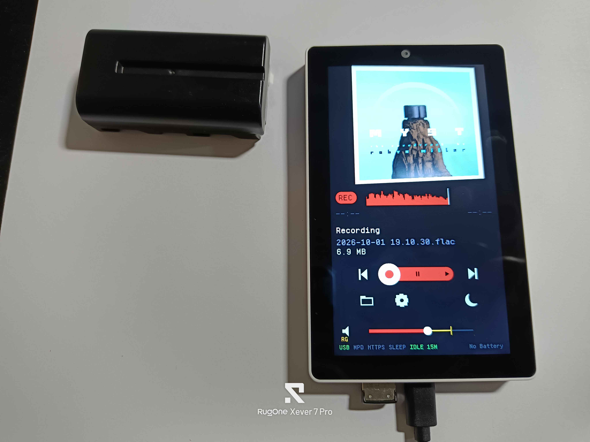

# Defeatist Music Player *per M5Tab5*

[English](README.md) · [简体中文](README.zh-CN.md) · [日本語](README.ja.md) · [Español](README.es.md) · [Português](README.pt.md) · [Français](README.fr.md) · **Italiano**

La maggior parte dei lettori multimediali per l'M5Stack Tab5 ti dice di *convertire* prima i tuoi file. Questo no.

L'obiettivo di questo progetto è spremere tutto il potenziale di questo hardware senza modificarlo. Niente saldature, niente accessori che non si possano togliere dopo. Ogni formato che un ESP32-P4 v1.3 possa ragionevolmente gestire senza conoscere segreti.

> Questa è una traduzione automatica; la versione di riferimento è quella inglese, [README.md](README.md). Per le etichette brevi dello schermo, vedi [ABBREVIATIONS.it.md](ABBREVIATIONS.it.md).

## L'M5Stack Tab5 non è un lettore musicale ideale.

- Pensi che abbia il Bluetooth.
  - Ha il Bluetooth a basso consumo (BLE), il che significa che i dispositivi più vecchi con Bluetooth classico non lo vedranno mai.
  - LE Audio / Auracast richiede un altro cablaggio e altri profili. Potrebbe funzionare riflashando il C6, ma serve [attrezzatura speciale](https://docs.m5stack.com/en/guide/restore_factory/m5tab5_c6_wifi).
- Ha una presa per cuffie con microfono.
  - Ottima per delle cuffie con microfono. O un cavo AUX. O, in teoria, per registrare.
  - Ma niente ascolta i tasti del telecomando sul cavo. Si possono collegare, a quanto pare. Il che, di nuovo, vuol dire attrezzatura speciale (ma non troppo).
- Schermo e touch sono gestiti dallo stesso chip. Si può spegnere la retroilluminazione per risparmiare energia, ma non si può spegnere del tutto lo schermo.
- E tutto il pasticcio dei controller dello schermo.
  - Prima uscita (2025.5.9): controller dello schermo ILI9881C separato + controller touch GT911
  - 2025.10.14: passato al controller integrato schermo-touch (TDDI) ST7123
  - 2026.4.28: il chip del controller è passato da ST7123 a ST7121 (è quello che mi è arrivato)

## I tre scenari

1. Non ho memoria, ma ho il Wi-Fi (o un adattatore Ethernet): puoi ascoltare la radio via internet.
2. Ho memoria, ma niente musica: puoi registrare file FLAC da ascoltare dopo.
3. Ho memoria e musica: questo è il tuo lettore musicale — con o senza cuffie, adattatori USB Audio Class (UAC) supportati.

## Ecco cosa sono riuscito a far funzionare su ESP-IDF ~~5.5.5~~ 6.1

- Inserimento a caldo di scheda microSD e chiavetta USB
  - La microSD è preferibile. Consuma meno.
  - Monta comunque l'USB da solo se disponibile, purché l'indicatore USB sia verde. Se non lo è, riaccendi l'alimentazione USB nelle impostazioni.
- Supporto exFAT
  - Provate schede SDHC e SDXC (anche se la seconda è morta dopo una settimana, non per colpa del software). SDUC no. File audio grandi come un Blu-ray suoneranno? Boh.
- Passaggio automatico dalle cuffie all'altoparlante interno allo scollegamento, e viceversa
  - L'icona accanto al cursore del volume mostra cosa sta suonando davvero — un altoparlante, delle cuffie, o `UAC` quando un dispositivo audio USB ha l'uscita. Toccarla toglie e ridà l'audio.
- Supporto per tutte le varianti del formato MP3 (per quanto ne so). Questo coso ha libreria di riserva dopo libreria di riserva. FLAC, Ogg, WAV, i classici ci sono.
- Copertina: che l'immagine sia nel file, o il cover.jpg / folder.jpg / front.jpg dell'album accanto.
- Stato della batteria, a parole in fondo alla riga di stato: `BATT 73%`, `CHRG 73%`, `CHARGED`, `NO BATT`.
- Wi-Fi sulla riga di stato: verde connesso, giallo in connessione, grigio spento.
- Controllo del volume
- Riproduci/pausa
- Inizio brano / brano precedente (doppio tocco)
- Brano successivo
- Spegnimento dello schermo
- Trascina per spostarti nel brano. In tutti i formati della lista sopra.
- Il pulsante dell'ordine di riproduzione passa per ONE / ALL / RPT / EAT / RND / RPT1 — cosa fa ognuno, e tutte le altre etichette brevi dello schermo, è in [ABBREVIATIONS.it.md](ABBREVIATIONS.it.md).
- Forma d'onda del volume sulla barra di avanzamento. Mi sembrava bella.
- Supporto USB Audio Class — quell'adattatore "cuffie Bluetooth sulla mia PS5" funziona anche qui. Solo porta USB-A.
- La pausa toglie corrente all'amplificatore.
- Cache in SDRAM. Se noti stranezze 20 secondi prima di un cambio di brano, apri una issue.
- Supporto ReplayGain. La prima volta che ascolti un brano per intero, Defeatist lo ascolta con te — così agli ascolti successivi alza i brani più bassi e abbassa quelli più forti, entro limiti ragionevoli. Ragionevoli secondo [BS.1770](https://www.itu.int/rec/R-REC-BS.1770/en).
  - La forma d'onda della barra di avanzamento viene da quello stesso ascolto. Finché un brano non è stato sentito per intero una volta, la sua barra resta grigia uniforme.
  - Saltare o spostarsi durante quel primo ascolto lo annulla — ci riprova la volta dopo.
  - Questi metadati sono in un file nascosto `.songname.rgcache`. Il calcolo non si può disattivare; la regolazione del volume sì, nelle impostazioni.
- ARK 12 copre una buona parte di Unicode, ma non è perfetta.
- Riapre l'ultimo brano ascoltato all'avvio. Senza riprodurlo da solo.
- Dissolvenza di 3 secondi alla rimozione del supporto.
- Dissolvenza incrociata regolabile.
- Rispetta davvero i dati di riproduzione senza pause (gapless).
- Radio via internet tramite l'API di <https://www.radio-browser.info>, o con un elenco manuale. Qui si entra nel territorio "resta attaccato alla presa".
  - Stream MP3, AAC e Ogg, e HLS (`.m3u8`) con AAC o MP3 in segmenti semplici o MPEG-TS. Non ancora: HLS cifrato o fMP4, né i link `.pls`/`.m3u` serviti da una radio.
- Titoli e nomi di radio in arabo, legati e disposti da destra a sinistra, contro il margine destro.
- Timer di spegnimento (fino a 2 ore, a passi di 15 minuti).
- Spegnimento dopo 15 min a 2 h senza riprodurre, registrare né toccare — separato dal timer. `IDLE` sulla riga di stato è verde durante il conto alla rovescia e giallo quando qualcosa lo trattiene; il tasto laterale lo riaccende.
- Protezione batteria scarica: sotto i 6,3 V per 30 s a batteria, termina ogni registrazione e si spegne da solo, prima che la batteria si scarichi tanto da rovinarsi. Non ancora provato su una scarica reale.
- Controllo della luminosità.
- Network Time Protocol (NTP), se il Wi-Fi è configurato.
- L'orologio con batteria tampone mantiene l'ora dopo lo spegnimento, così le registrazioni hanno il nome giusto anche senza Wi-Fi; l'NTP la corregge quando può.
- Configurazione Wi-Fi con portale captive (più router).
- Inserimento manuale di radio internet dal portale web del Wi-Fi.
- Preferiti con la stella.
- Adattatori Ethernet USB: CDC-ECM (Realtek RTL8152 provato; RTL8153 stessa strada, non provato) e un porting dell'[ASIX AX88772](https://github.com/Sudrien/esp_usbh_asix), entrambi confermati sulla scheda.
- File cue.
- m3u/m3u8 — almeno tramite MPD.
- Ah già, il supporto a [Music Player Daemon](https://mpd.readthedocs.io/en/stable/user.html) — sì, dovrebbe voler dire anche controllo da Home Assistant.
- Interfaccia web in HTTPS.
- Registrazione audio, visto che l'hardware è lì, in FLAC.
  - con un indicatore di livello mentre registra.
- Una riga di stato sotto il volume: alimentazione USB, MPD, HTTPS e i minuti rimasti del timer. Verde è acceso.
- Santo cielo, ho guardato l'elenco delle app di M5Launcher, sistemiamo subito l'ordine del titolo.
- Lingue dell'interfaccia (English, 简体中文, 日本語, Español, Português, Français, Italiano), da scegliere nell'ingranaggio delle impostazioni >> scheda BUILD.
- Supporto a [bmorcelli/Launcher](https://github.com/bmorcelli/Launcher)
  - uscita di ritorno al launcher
  - importazione delle credenziali Wi-Fi
- Ho separato le librerie per https://github.com/Sudrien/lothesome-audio-analyzer-for-m5tab5 ... un errore? forse
- Qualche filtro
  - regolazione dei bassi
  - regolazione degli alti
  - cancellazione della voce basata sullo stereo
  - eco configurabile
  - passa-alto
  - passa-basso
  - regolazione della larghezza
  - fruscio (crepitio del vinile)
  - filtro di flutter
  - filtro di wow
- velocità di riproduzione (per i file)
  - Sono numeri da giradischi, ci arriverai.

## Cosa potrebbe succedere

- Più gestione dei crash; ehi, puoi sempre collegarlo a `idf.py monitor` e vedere cosa salta fuori.
- Un downloader di podcast via Wi-Fi? Concepibile. Vorrei il supporto dei capitoli.
  - c'è così tanto. Così tanto.

## Cosa non può succedere con il codice pubblicato attuale

- Adattatori Bluetooth classico.
- Ripresa per singolo file.
- Hub USB.
  - Capisce che ne hai collegato uno? Sì.
  - Riesce a usare quello che ci colleghi? Probabilmente no.
  - Uno ti salverà se il tuo dispositivo assorbe abbastanza da far crollare la tensione del Tab5? Ehm. Definisci "salvare".
  - Quello che le librerie non supportano sono più velocità di dispositivo, e non so dirti la velocità di un dato dispositivo.
- I file con DRM sono esclusi.
- DSD e APE richiedono troppa elaborazione.

## Possibili problemi

- Le reti Wi-Fi salvate e il certificato del telecomando stanno nella NVS della scheda, namespace `defeatist`. Sotto un launcher su scheda SD, ogni firmware condivide quella partizione: un'altra app può leggerli (qui la NVS non è cifrata), e una che cancella la NVS se li porta via. Le impostazioni tornano dalla scheda; le reti e il certificato no.

- Caricare da un USB-C troppo debole + batteria inserita + schermo acceso può dare quello che sembra un fischio dell'altoparlante, ma non lo è. Prendi un cavo USB migliore, un hub migliore, un collegamento diretto al caricatore. Ti mancano ampere.
- La selezione dei file è un po' più lenta di quanto vorrei, perché selezionare il primo brano sotto il pollice non è quello che vuoi.
- I cavi AUX non sono per forza schermati abbastanza contro tutto quello che può esserci intorno. Vale la regola elettromagnetica "allontana il telefono".

## Licenze

- Questo codice è MIT, come i quattro componenti feckless-*-for-m5tab5 che scarica via git — tranne i font, sotto.
- minimp3 è CC0-1.0 (dedica al pubblico dominio). Nessun obbligo di attribuzione. Non è nel repository: `cmake/vendored.cmake` lo scarica a un commit fisso e controlla uno SHA256, così il sorgente resta verificabile.
- esp_audio_codec è distribuito come **archivi precompilati** con la licenza ESPRESSIF MIT. Gratuito, ma la concessione è limitata al silicio Espressif. Qui va bene; utile saperlo prima di copiare questo codice altrove.
- pngle (kikuchan) e miniz (Rich Geldreich et al.) sono MIT, scaricati come minimp3. L'unica condizione della MIT è che l'avviso di copyright e di permesso accompagni "tutte le copie o parti sostanziali", e un'immagine firmware è una copia: una ridistribuzione binaria porta i loro avvisi (le intestazioni di `pngle.c` e `miniz.c` scaricati) accanto al `LICENSE` di questo progetto.
- stb_image (il decoder JPEG di ultima istanza in `components/stbjpeg`) è di Sean Barrett, a scelta sotto MIT o Unlicense (pubblico dominio). Questo progetto lo usa sotto Unlicense, quindi non aggiunge avvisi da portare. Il wrapper intorno è MIT.
- **`components/usb_host_msc` e `components/usb_host_uac` sono di Espressif, Apache-2.0, non MIT.** Sono copie incluse e modificate dei driver di classe di esp-usb; ognuna mantiene il proprio file di licenza, e i file modificati mantengono le intestazioni SPDX di Espressif con una riga "Modified by" sotto (Apache-2.0, sezione 4(b)); i manifest inclusi dicono `license: "Apache-2.0"`. Una ridistribuzione porta quei file di licenza.
- Il fatfs con exFAT che `cmake/exfat.cmake` include alla configurazione è il componente di IDF (Apache-2.0) attorno al FatFs di ChaN (licenza FatFs, un avviso stile BSD a una clausola che va mantenuto).
- **TJpgDec è di ChaN, con una sua licenza**, e arriva come componente `espressif/esp_jpeg`. Permissiva — libera per uso personale e commerciale, ridistribuzione del sorgente consentita — ma l'avviso di copyright va mantenuto, quindi viaggia con una ridistribuzione come fa l'OFL del font. Usato solo come riserva, per le copertine che il decoder JPEG hardware non riesce ad allocare: il decoder del P4 non ha scalatura, quindi una copertina da 3000 px vuole 17 MB di PSRAM in un solo blocco e non li ottiene.
- **Ark Pixel Font è SIL OFL-1.1, e quindi anche le tabelle `ark12` in feckless-graphics-handler-for-m5tab5 (`fonts/ark12`) sono OFL-1.1, non MIT.** Convertire i PNG dei glifi in array C rende quei file una Versione Modificata secondo la sezione 5 dell'OFL, e la sezione 5 richiede che le Versioni Modificate restino sotto OFL. Non è un problema — l'OFL permette esplicitamente di distribuirlo insieme a software con qualsiasi licenza, e sono vincolati solo i file del font — ma `fonts/ark12/LICENSE-OFL` deve accompagnare ogni ridistribuzione, immagine firmware compresa, e le tabelle non vanno vendute da sole. Ark non dichiara alcun Nome di Font Riservato (Reserved Font Name), quindi il derivato non doveva essere rinominato; si chiama `ark12` comunque, perché non è la Versione Originale.
- **Arabixel Basic è CC BY 4.0** (ArabianDev, <https://arabiandev.itch.io/arabixel-basic-font>), e lo sono anche il file del font e la tabella generata in `fonts/arabixel` di feckless-graphics-handler-for-m5tab5; il suo codice di shaping è MIT. La CC BY (<https://creativecommons.org/licenses/by/4.0/>) chiede attribuzione, un link alla licenza e una nota delle modifiche — il README del componente e l'intestazione della tabella li riportano, e una ridistribuzione, immagine firmware compresa, tiene con sé `fonts/arabixel/LICENSE.txt`.
- MurmurHash2 è di pubblico dominio.

## Contribuire

Se vuoi commentare le traduzioni o le funzionalità, apri una issue su GitHub, su https://github.com/Sudrien/defeatist-music-player-for-m5tab5

Se vuoi contribuire con del codice, leggi CONTRIBUTING.md e CLAUDE.md per le regole di formattazione.

## «Aurora Player — BT Mode»

- loro usano Codex, io uso Opus, nessun problema
- Sì, installare un modulo ESP32-PICO-D4 dà accesso al Bluetooth classico
- Scrivo partendo dal presupposto che la maggior parte delle persone non voglia modificare l'hardware in modo permanente
- Non posso ancora consigliarli finché
  - non avranno un vero repository pubblico del codice sorgente (non deve per forza essere git)
  - non pubblicheranno le informazioni sulle licenze (le librerie che usano lo richiedono)
  - non avranno un URL migliore di https://frolicking-bonbon-c32cfa.netlify.app/
  - 'feedback welcome' NON PORTERÀ DAVVERO DA QUALCHE PARTE DOVE LASCIARE UN PARERE
  - non avranno note di rilascio che siano davvero note di rilascio

## Un'ultima frecciata

- waveflow for tab5 music player
  - puoi persino generare con l'IA un logo per il dispositivo giusto
  - dite alla gente di scaricare ffmpeg e POI uno script di conversione????????? Quando magari non hanno nemmeno Python per cominciare???? shmusica, ma dai
  - comunque si chiama "transcodifica"
  - La vostra mancanza di lavoro mi ha assicurato che il vibe coding ha i suoi livelli
